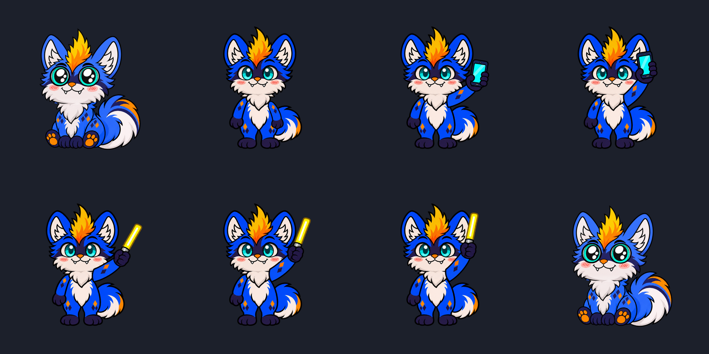

# Yohta mohawk chibi

Yohta **sits at rest and stands only for music**, using the approved saturated
chibi design. Import this folder with the updated TinyPaw build. Enable Music;
select **Light wave** to wave the phone or glow stick. A saved local music
style remains your choice. The bundled default Yohta is unchanged.



Top row: sitting, standing with a relaxed arm, then phone wave at both extremes.
Bottom row: three glow-stick wave positions, then sitting again.

## Feature and artwork requirements

A body PNG and `character.json` suffice for a basic character. Extra artwork
is required only for selected features. These are the current mapped assets;
earlier experimental seated-wave images remain authoring references only.

| Feature | Artwork requirement | Yohta mapping |
| --- | --- | --- |
| Sitting at rest | Body plus optional separate head/tail | `sit/body.png`, `sit/part-1-head.png`, `sit/part-2-tail.png` |
| Head tilt | Separate head, neck pivot | `sit/part-1-head.png` |
| Tail sway / wag / carry lag | Separate tail, attachment pivot | `sit/part-2-tail.png` |
| Cursor-tracking eyes at rest | Per eye: white/background, pupil and socket mask | `sit/eye-{1,2}-{white,pupil,mask}.png` |
| Blinking at rest | Closed eye art or head expression | `sit/eye-{1,2}-blink.png`, `sit/part-1-head-blink.png` |
| Pressed head expression | Optional replacement head with painted eyes | `sit/part-1-head-pressed.png` |
| Dragging head expression | Optional replacement head with painted eyes | `sit/part-1-head-dragging.png` |
| Click: None / Compress | No extra image | Runtime effect |
| Click: Use artwork | Optional complete replacement image | `reactions/click.png` |
| Ordinary pickup and carrying | No extra image | Captured-contact runtime movement |
| Alternate held pose | Optional complete held image aligned to pickup contact | `held.png` |
| Drop: Use artwork | Optional complete replacement image | `reactions/drop.png` |
| Fall to screen edge | No extra image | Enable Fall separately |
| Music: standing body | Optional complete standing body with viewer-right arm omitted | `music/standing-body.png` |
| Music: relaxed arm | Matching relaxed viewer-right arm | `music/standing-relaxed-arm.png` |
| Music: phone wave | Complete naturally raised arm, paw and held phone | `music/standing-phone-arm.png` |
| Music: glow-stick wave | Same raised arm and grip with glow stick | `music/standing-stick-arm.png` |
| Music: Nod / Groove / Rubber hose / Compress | No new frames beyond standing body and relaxed arm | Runtime whole-pose movement; no raised item |
| Music: Random | Images for the included styles | Both authored items supplied; Light wave is eligible |
| Music lighting | No extra halo required by this four-image set | Bright cores/screens are painted into items; no background vignette |
| Headpat and affection | No required image; optional happy head or complete pose | `sit/part-1-head-petted.png`, `reactions/headpat.png` |
| Seated sleep | Optional complete sleep image, or closed-eye resting rig | `reactions/sleep.png` |
| Curled sleep | Extra complete sleeping image with placement and mouth origin | `reactions/sleep-curled.png` |
| Multiple sleep positions | Up to eight complete sleeping images | Two positions registered |
| Sleep entry / breathing / Zzz | No animation frames or Zzz PNG | Runtime effects, per-pose mouth origin |
| Touch / click / pickup / audio / random wake | No required image; optional wake artwork | `reactions/wake.png` |
| Dialogue | Text entries, no images | 74 lines across nine events |
| Reaction sounds / spoken lines | Optional managed WAVs, no images | No sound files assigned |
| Size / placement / reduced motion / hiding | No extra image | Runtime controls |
| List thumbnail | Optional preview PNG | `thumb.png`, showing the seated resting rig |

The standing body is a complete painted pose, including its face and tail.
Cursor eye tracking, blinking, head expressions and independent tail motion
resume on the sitting rig. The standing arm swings gently around its actual
shoulder; fingers and items stay together because their approved anatomy is
authored as one sprite. This avoids reconstructing the rejected floating grip.

## Music switching and alignment

All runtime images share a transparent **1024 x 1024** stage. Standing and
sitting feet use the same desktop ground placement. Never crop or recenter
registered layers independently.

Optional `music.artwork` in `character.json` stores four image paths and the
shoulder pivot:

```json
{
  "music": {
    "bop": "light_wave",
    "artwork": {
      "body": "music/standing-body.png",
      "relaxed_arm": "music/standing-relaxed-arm.png",
      "phone_arm": "music/standing-phone-arm.png",
      "stick_arm": "music/standing-stick-arm.png",
      "pivot": [0.52734375, 0.5693359375]
    }
  }
}
```

Playback activates standing. Brief gaps below 0.65 seconds keep the pose;
sustained silence restores sitting. Turning music off settles through that
same short grace period. Press/carry, reaction artwork and sleep take priority.
Reduced motion uses the standing pose with a still relaxed arm.
Packs without this optional block keep their existing rendering.

The normal layered Light wave system also supports separate `left_arm`,
`right_arm`, `holding_arm`, `grip`, `phone`, `glow_stick`,
`phone_glow` and `stick_glow` parts. Those remain available to other packs.
Yohta now uses the complete standing-arm alternatives above.

Curled sleep uses placement `[0, -0.025, 1]`, mouth `[0.36, 0.695]`.
Seated sleep uses mouth `[0.41, 0.53]`. Breathing, hearts and Zzz are runtime
effects. Automatic sleep requires local activation after import.

## Other optional artwork supported by TinyPaw

| Optional feature | Artwork if selected | Mapping |
| --- | --- | --- |
| Static separate eyes | Complete left/right eye PNGs instead of tracking components | Head-attached `other` parts |
| Separate eyebrows / face details | One image per detail | Head-attached `other` parts |
| Ear twitch / floppy ears | One image per independent ear | `ear`, ear-base pivot |
| Wings | One image per wing | `wing`, wing-root pivot |
| Springy hair | One image per tuft | `hair`, root pivot |
| Other moving accessories | One image per accessory | `other`, attachment pivot |
| Additional named resting poses | Body and parts/eyes for each pose | Complete `poses` entries |

These are optional extensions, not missing Yohta assets. Animated frame
sequences, roaming and window-top landing are outside this artwork set.

## Dialogue

All existing lines are retained, with six additions per event: **74 total**.

| Event | Manifest key | Lines |
| --- | --- | ---: |
| Click | `click` | 9 |
| Pick up | `drag` | 8 |
| Drop | `drop` | 8 |
| Idle | `idle` | 9 |
| Music starts | `music` | 8 |
| Annotation ends | `annotation_end` | 8 |
| Headpat | `headpat` | 8 |
| Sleep | `sleep` | 8 |
| Wake | `wake` | 8 |

Pickup dialogue uses `lines.drag`; held art uses `reactions.pickup.held_pose`.
The reaction `enabled` flag controls sound independently of artwork.
Music and headpat lines do not repeat on every beat or stroke.

## Sources and verification

The built-in image generator produced `artwork-sources/standing-production.png`
from the approved saturated standing concept. Exact prompt:
[standing-production-prompt.txt](standing-production-prompt.txt).
`tools/prepare_yohta_standing.ps1` registers the four production sprites.
Previous source sheets and the seated-wave preparation tool are retained as
design history; their experimental sprites are no longer mapped.

`editor/sources` preserves the editable seated rig. Artwork saves and exports
preserve the optional standing music block and all four referenced images.
Unused concept sheets and this README are authoring material, not runtime layers.

- `cargo test` covers controller behavior, input priority, silhouette hit testing,
  editor preservation, import/export, sleep and dialogue.
- `cargo test render_mohawk_yohta_music_artwork -- --ignored --nocapture`
  regenerates `music-preview.png` and the seated `thumb.png` using TinyPaw's renderer.

The preview checks both items and swing extremes. Real audio/device timing
and mixed-DPI native playtesting remain release checks.
