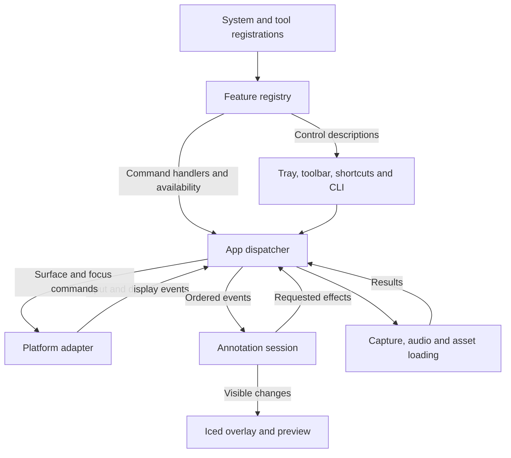

# TinyPaw architecture

Design for the first implementation. The [product scope](scope.md) defines feature behavior, platform targets and performance budgets. This document maps those requirements to the running system, the annotation engine and the desktop interface.

## System map

One resident Rust process owns the session. The CLI forwards commands to that process over a per-user local endpoint. The game and Discord are outside the process boundary. Discord consumes the shared monitor through its own capture workflow.

The UI thread is the only writer of session state. Mouse clicks, tray actions and shortcut presses reach the same commands, so toolbar state and input behavior agree. Handle pointer events for the active surface locally. Use asynchronous work for media decoding, capture authorization and device operations that could stall the UI. Carry a session generation and request ID on asynchronous results. Turning Off advances the generation before releasing resources, so a late reply cannot restore the old overlay. If acquisition fails on one of several target displays, unwind the partial activation and report the failure.

## Feature registry and system boundary

Every user-facing command and configurable option enters through one registration interface. Build the registry once at startup from an explicit list of built-in Rust modules. Freeze its definitions after validation. The registry owns definitions and lookup indexes. Current values live in preferences, and live tool state lives in the session. Derive selected, enabled and checked indicators from those owners.

| Owner | Responsibilities |
| --- | --- |
| System | Own the process, input ownership, surfaces, focus, capture and audio devices, persistence, rendering and the shared undo sequence. Register user-facing system controls such as Master On/Off, display selection and Undo through the same interface as tools. Internal lifecycle events such as session lock go directly to the engine. |
| Feature module | Declare its commands, settings and presentation metadata together. Supply handlers for its behavior and, when interactive, supply the active-tool input and drawing callbacks. Request typed effects from the host. Keep native handles and Iced widgets inside their adapters. |
| Registry consumers | The picker, toolbar, tray and settings window enumerate entries for their surface and group. Shortcut bindings and CLI commands resolve the same registered command IDs. The dispatcher checks availability even for invocations arriving outside the UI. |

**Registration contract.** Each built-in supplies `register(&mut Registrar)`. Three entry types cover the first release:

| Entry | Declared once | Used by |
| --- | --- | --- |
| Command | Stable namespaced ID, label, permitted surfaces, group/order, optional shortcut, availability and handler. | Tray, toolbar, picker, shortcuts and CLI dispatch. Availability returns a reason, such as capture unavailable or session Off. |
| Setting | Stable namespaced ID, label, group/order, value type, default, constraints and availability. | Settings controls, preference loading, validation and reset. One typed setting update path serves every editor of that value, including quick controls. |
| Interactive tool | Selection command, feature-owned state factory, input handler and drawing callback using shared scene primitives. | Session and overlay. Resolve the active tool on selection; pointer movement and rendering call that tool directly. |

**Example: Spotlight.** Its module registers the `spotlight.select` command in the tool picker and the `spotlight.radius` numeric setting under Appearance. The setting declaration supplies its initial value and slider bounds. Choosing Spotlight by keyboard or picker runs the same selection handler. Its drawing callback reads the validated radius and pointer position and emits a dim mask. Adding a dimness option later requires a declaration and a read in Spotlight's drawing code. The settings page, config loader, shortcut router and platform adapters need no Spotlight branches.

**Adding a feature.** Implement the module, add its registration to the built-ins list and verify its behavior. A new OS capability or a genuinely new drawing primitive can extend the host contract as a separate change. Load Yohta and imported packs as data through the registered Point feature. Keep pack import separate from executable feature registration.

**Contract checks.** Reject duplicate IDs, dangling command references, invalid defaults and ambiguous default shortcuts in overlapping contexts. Test that picker and shortcut invocation yield the same command result, that an unavailable action is also refused via CLI, and that setting edits, reset and restart round-trip through the declared schema. Preserve stable preference IDs across releases or migrate renamed entries. The first integration test adds a small feature with one action and one setting using only its module and the built-ins list.

## Engine map

| Engine responsibility | Decision |
| --- | --- |
| Session and input | Off, Passthrough and Annotating are mutually exclusive. Track why TinyPaw owns input (latched or held) so a stale key release cannot end a latched session. A pending acquisition grants ownership only when the platform acknowledges it. |
| Gestures and tools | Point handles tap and drag. Text, Pin, Spotlight and Lens interpret events on the same surface. Freeze selects a scene, so the user can point, label and draw on the still. The editor gets keyboard and IME events before single-key tool commands. |
| Scenes and undo | Keep a live scene with an ordered list of strokes, labels and pins. Each mark carries its output ID and logical coordinates. Freeze owns a separate list and one frame for the selected target. Undo removes the newest eligible mark in the current scene. Return Live releases the still and reveals the prior live marks. |
| Output and coordinates | Convert device input to logical coordinates at the platform boundary. Store output ID, logical bounds, scale and transform. Map logical coordinates into capture-source pixels only when sampling a lens or still. End a stroke at a display boundary before starting a segment on another target. |
| Drawing and animation | Composite from back to front: frozen image if present, spotlight mask, committed marks, active gesture or draft, lens and paw, then controls. Cache committed paths per display. Repaint on input, frame arrival or an active animation deadline. Passthrough with static marks waits for events. |
| Capture and sound | The capture module offers two source kinds: a one-shot still of the target display for Freeze, and a live source for Lens that prefers the game window so the overlay stays out of the frame. Lens reads the newest source frame, dropping superseded frames. Freeze retains one immutable frame. Keep native image buffers outside annotation history. Tap playback uses the decoded sample for the active pack. Audio failure leaves pointing usable; capture denial leaves annotations usable. |

**One gesture through the engine.** With TinyPaw enabled in Hold-to-draw mode, key-down requests input on the chosen monitor. Pointer-down starts a possible tap. Crossing the drag threshold turns it into a stroke. If the hold key goes up before the mouse button, commit the path and hide the paw immediately. Consume the matching button-up before making the surface click-through. The game then receives subsequent input, and viewers still see the circle. Master Off clears the circle and disarms the hold binding.

**Freeze sequence.** The Freeze command runs from an enabled Live scene in a fixed order. Hide the paw, toolbar and live marks on the target display and wait for one presentation. Request a one-shot still tagged with the session generation and a request ID. Show the still as an opaque back layer. Only then acquire input and focus and enter Point in the Frozen scene, so a game that pauses on focus loss is captured while still running. If capture fails or is denied, restore the live marks and stay in the previous state. A second press or Return Live releases the still and its marks, reveals the live marks and returns to the state Freeze started from. Master Off cancels a pending still. On Windows, try Desktop Duplication first, since Windows Graphics Capture can draw a border around the captured display on older Windows versions.

## Code layout

**Point rendering.** Register one pack-aware presentation setting in Point. Both overlay and preview use the same pose calculation. Position the paw from its hotspot first. Furry Paw draws that sprite alone. For Classic Stick or Stretch Paw, derive a grip below and right of the cursor and paint the attachment behind the wrist. Classic Stick draws a straight shaft. Stretch Paw maps the optional forearm texture along a short segmented curve, with a bounded, elapsed-time-driven bend on direction changes. Keep the wrist joined and place the claw at the exact input coordinate in every frame. Reduced motion uses an immediate straight reach. Share hit testing, taps, ink and undo across all presentations. Clip to the active display, stop redraws when settled, and render the laser separately. See [paw presentations](scope.md#paw-presentations).

Use one Cargo package. The paths below are proposed module homes. Create each when its first feature lands.

| Path | Owns |
| --- | --- |
| `src/main.rs`, `src/app.rs` | Resident startup or CLI forwarding, Iced event loop, dispatch and effect completion. |
| `src/registry/` | Registration contract, definition validation and lookup indexes. Shared by the shell and engine. |
| `src/features/` | Built-ins list and modules for Point, Text, Pin, Spotlight, Lens and Freeze. Each module registers only the entry types it uses. |
| `src/session/` | Input ownership, scene data, undo and lifecycle for the selected tool. This module can run in a unit test with logical events and an explicit timestamp. |
| `src/view/` | Overlay layers, toolbar, settings and preview. Render borrowed scene data and emit user intents. |
| `src/platform/` | Window roles, input regions, focus, native shortcuts, display topology and local command transport. Compile Windows, macOS or Linux adapters for the relevant target. |
| `src/capture/` | One-shot display stills for Freeze and live sources for Lens. Platform capture sources, source-to-output mapping, frame lifetime and cancellation for Lens and Freeze. |
| `src/packs.rs`, `src/preferences.rs`, `src/audio.rs` | Validate style folders, persist user overrides and predecode/play the current tap. Save preferences atomically. |
| `assets/packs/`, `assets/sounds/` | Ship Yohta, Moro, Zaeri and Aamox as separate pack directories. Store shared tap presets once under stable sound IDs. Discover pointers and presets as data behind the registered Point and Sound controls. Add your pointer and folder import both validate and install through the pack loader. |

## Desktop layout

The shell defines the layout slots and their keyboard navigation. The following rows describe the intended arrangement. The registry supplies the entries, ordering, current selection and availability for those slots from definitions and session state.

| Surface | Proposed arrangement |
| --- | --- |
| Tray or menu bar | First row shows the master On/Off state and switches it with one action. Then Annotate (latch), Settings and Quit. The tray remains reachable when the drawing strip is hidden. |
| Game monitor | The paw and marks appear over the game. While annotating, show one compact strip at the bottom center of the active target. Put the current tool and its picker first, followed by Undo, Clear, Mute and Exit. Keep these controls reachable by mouse and keyboard. In Passthrough only committed live marks remain. |
| Tool picker | Offer Point, Text, Pin, Spotlight and Lens. Point opens the paw/laser choices. Offer Freeze as a scene action. In a frozen scene show a persistent Frozen indicator and Return Live action. If capture is unavailable, explain the limitation beside Lens or Freeze. |
| Settings | Use a left navigation column for Controls, Display, Appearance and Sound. The main pane shows only the selected group. Appearance includes the paw pack, ink, labels, lens size and a light/dark preview. Put the master switch and its shortcut in the window header. Apply changes immediately. |
| Multiple monitors | Keep settings on the display the user chose for that window. Show the control strip on one target at a time and keep its position stable while a menu is open. Other outputs render only their own marks. Hiding the strip for a stream leaves the master hotkey and tray available. |

## Future Stream Output

**Decision: defer until after the Discord monitor-share playtest.** Keep annotation drawing separate from the toolbar and input surface. Give the drawing code a read-only scene and a destination viewport. Keep source bounds, scale and frame lifetime in the capture module used by Lens and Freeze. These boundaries already serve the overlay and preview in v1. Defer the second window, continuous game capture and audio routing to a future implementation.

If scheduled, register start/stop commands through the existing feature registry. Only an explicit start opens a shareable output window and starts capture of the chosen game. Draw that frame plus the same annotation scene, clipped and mapped to the game content rectangle. Keep toolbars and draft editing controls local. The output consumes scene state without taking gameplay input. Stop capture and release the window on explicit stop or master Off. On source loss, blank the output and request reselection; preserve the user's game-only sharing boundary.

Before shipping, verify from a second Discord client that Alt+Tab does not expose another app, marks align after a resize or scale change, and game audio reaches the viewer as intended. Compare frame pacing and resource use against the v1 monitor-share baseline.

## First implementation milestone

Build the path from tray or shortcut through the session to a placeholder paw and one stroke on a real overlay. Start on Windows and repeat on Niri before expanding the toolbar. Verify both key-release orders, zero-alpha hit testing, mixed-DPI alignment, and a remote Discord viewer seeing the mark in a monitor share. Measure idle memory and CPU, first activation, frame pacing and game frame times using the targets in the scope. Record whether the game pauses, mutes or keeps receiving mouse input while TinyPaw has focus. Only then add persistent customization, more annotation tools and finally capture-backed tools, starting with Freeze on Windows. When Freeze lands, verify the time until the still appears, HDR colors against the live game, and that no capture border shows in the Discord share. No platform or footprint result has been measured yet.
