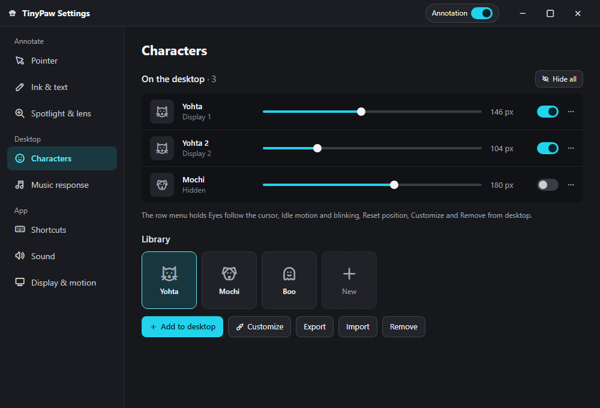
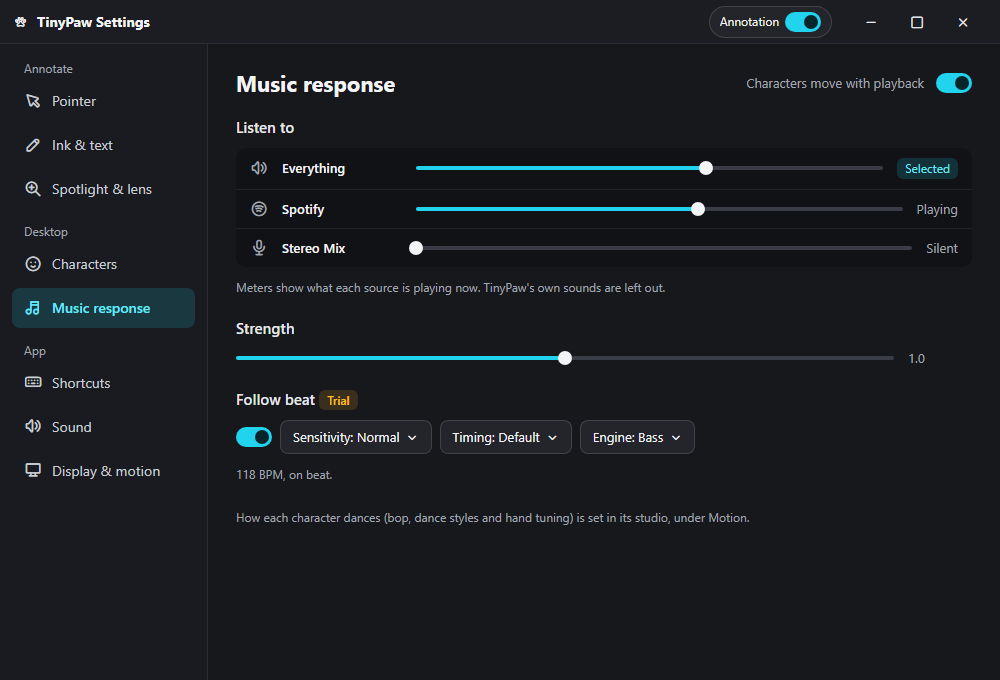
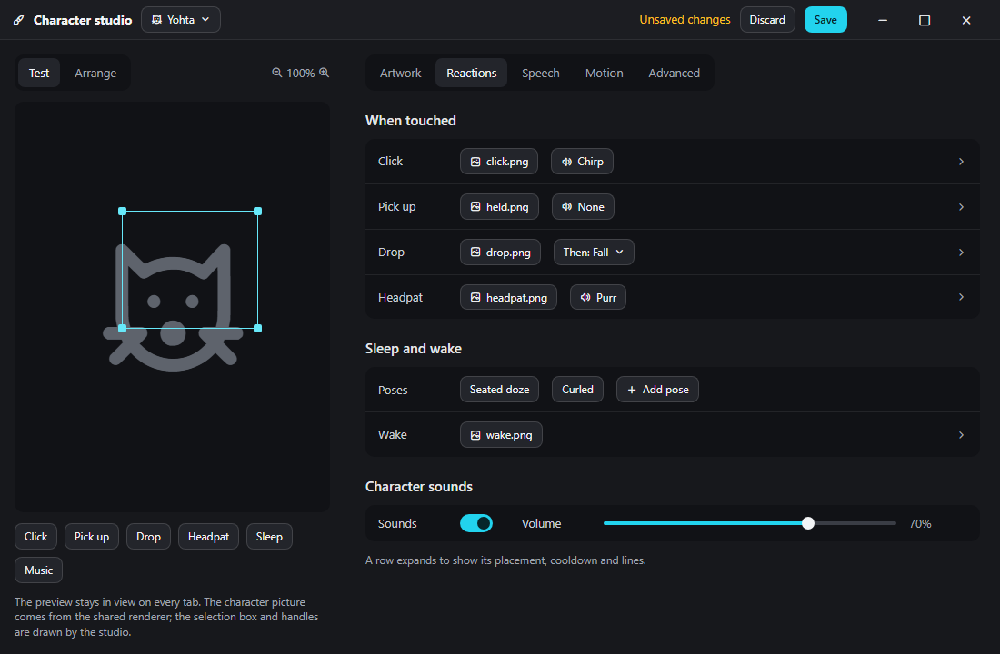

# Settings, character studio and multi-character plan

Updated 15 November 2026. Work on branch `refactor/settings-registry`; steps 0 to 6 are implemented, step 7 is in progress.

This plan replaces the single event loop with three, moves characters to a native stage, rebuilds Settings and the character editor in a UI framework with an enforced design system, and adds several characters on the desktop. The [character and editor improvement plan](character-editor-improvement-plan.md) still governs artwork, poses and editor content. This document governs architecture, windows and delivery order.

## Outcome

- Ten or more characters run on the desktop, including several of the same character, and they are aware of each other.
- Settings is a list of registered pages and sections. Every control saves at once.
- Character editing happens in a separate Character studio window that works on a draft with one Save.
- Every window draws from one set of design tokens and one component kit, guarded by templates, a guide and a check in the test run.

## Decisions

| Decision | Status |
|---|---|
| The character studio is its own window | Agreed |
| The same character may appear more than once, each a separate instance | Agreed |
| Characters are aware of each other | Agreed |
| No hard cap on instances; ten or more must work | Agreed |
| Design is guarded by templates, a guide and unified styles | Agreed |
| Voice volume, lines on or off and Quiet are app settings; music pose and its standing threshold belong to the character | Agreed |
| One master switch shows or hides all characters; each instance keeps its own shown flag | Agreed |
| Code is licensed GPL-3.0-or-later; character artwork is not covered by the code licence | Agreed; licence files added in step 1. Artwork is all rights reserved |
| Three loops, with characters on a native stage outside Iced | Proposed; assumed by this plan |
| Slint for Settings and the studio | Chosen. Step 0 measured it (see [Step 0 results](#step-0-results)) and the drag feel was confirmed by hand |
| Overlays and the quick bar stay on Iced | Proposed |

GPUI is the fallback for Settings and the studio if the Slint prototype fails on the canvas. It is not planned for overlays: it renders on the GPU only, and the overlay measured 640–820 ms to activate and about 180 MiB retained on a GPU surface (see [measurements](measurements.md)).

## Why the loop changes

All input, timers and results pass through one `App::update`, and Iced rebuilds the view of every open window after every message. The character's idle polling already drops to 15 per second while Settings is open to keep Settings responsive. With ten characters each ticking at display rate, every tick would rebuild every character window, Settings and the studio. This has been read from the code, not yet measured.

## Architecture

No per-frame traffic passes through the dispatcher. Frame clocks live inside the engines.


| Loop | Owns | Exchanges |
|---|---|---|
| Core dispatcher (the Iced `update`) | Session, registry, preferences, overlays, window lifecycle | Commands in, events out |
| Character stage (own thread and frame clock) | Instances, animation, physics, the awareness coordinator, drawing to per-pixel-alpha windows with tiny-skia | Intents in: show, move, settings changed, beat phase. Events out: clicked, dropped, menu requested |
| UI windows (Settings and studio) | Page state and drafts, in a process of their own | The `set` and command path the CLI uses over the local endpoint, and the current settings read back from the core |

Lens already follows this shape: `platform/lens.rs` owns native instances behind a controller. Known desktop characters built from 2D sprites, such as Shimeji, use the same native-window approach.

One renderer draws the character for the stage and for the studio preview, into a pixel buffer. The studio shows that buffer and draws only the editing overlay (selection, handles, guides) itself, so the preview cannot drift from the desktop.

Settings and the studio run as an on-demand process of their own, the same executable started with `--settings`. This was planned as a thread, but winit allows one event loop per process and Iced already owns it, so Slint cannot start a second one in the resident process (it fails with "EventLoop can't be recreated"). A process also frees the window's memory when it closes. The window talks to the core only through the command endpoint, which the CLI already uses.

The speech bubble is drawn by the stage. The right-click menu becomes a short-lived window.

## Design system

Today only colour is tokenised. View code holds 214 literal font sizes, 161 paddings, 196 spacings and 52 colours outside `theme.rs`.

- Tokens: colour, type scale, spacing, radii and control heights, in one source that feeds both Slint and the Iced overlays.
- Component kit: page, section, setting row, buttons, segmented tabs, card, list row, notice, save bar. Pages and studio tabs build only from the kit.
- Templates: a Settings page template and a studio tab template.
- Guide: `docs/ui-guide.md` with the tokens, each component and when to use it, layout and wording rules, and a checklist for adding a page.
- Guard: a check in `cargo test` that fails on raw sizes, spacing or colours outside the kit and tokens.
- Gallery: a debug page showing every component in every state.

## Windows

The mockups below are the target layouts. Their sources are in [ui-mockups](ui-mockups/): one HTML file per screen and a shared `mockup.css` whose colours mirror `src/view/theme.rs`. Character thumbnails are placeholder icons. To change a screen, edit its HTML and render it again (see [Rendering the mockups](#rendering-the-mockups)).

Settings navigation:

- Annotate: Pointer, Ink & text, Spotlight & lens.
- Desktop: Characters, Music response.
- App: Shortcuts, Sound, Display & motion.

### Settings → Characters



- On the desktop lists instances, one compact row each: thumbnail, name and display, size slider with its value, show or hide, and a menu.
- The row menu holds Eyes follow the cursor, Idle motion and blinking, Reset position, Customize and Remove from desktop.
- Hide all hides every instance without removing it.
- Library lists characters. Add to desktop creates another instance of the selected character, so one character can appear several times.
- Customize opens the Character studio for the selected character. New starts Add character in the studio.
- Remove is unavailable for the built-in character.

### Settings → Music response



- The switch in the title row turns music response on for all characters.
- Listen to shows each source with a live meter and its state.
- Strength and Follow beat apply to every character.
- Bop, dance styles and hand tuning are not on this page. They belong to a character and are edited in its studio under Motion.

### Character studio



- The header holds the character picker, the unsaved state, Discard and Save. One Save writes artwork and behavior.
- The preview pane is fixed and stays in view on every tab. Test plays the character; Arrange moves layers. The buttons under it trigger reactions.
- The character picture in the preview comes from the shared renderer. The studio draws only the selection box, handles and guides over it.
- Tabs: Artwork, Reactions, Speech, Motion, Advanced.
- A reaction row is a collapsed summary of its picture and sound. It expands to show placement, cooldown and lines.
- One studio is open at a time. Closing it or changing character with unsaved work asks Save, Discard or Stay.

Not drawn yet: the Artwork, Speech, Motion and Advanced tabs, an expanded reaction row, and the Add character and From reference flows.

### Rendering the mockups

From `docs/ui-mockups`, with Microsoft Edge installed. Settings screens are 1000×680 and the studio is 1100×720.

```powershell
& "C:\Program Files (x86)\Microsoft\Edge\Application\msedge.exe" --headless=new --disable-gpu --hide-scrollbars --virtual-time-budget=6000 --window-size=1000,680 --screenshot="$PWD\settings-characters.png" "file:///$($PWD -replace '\\','/')/settings-characters.html"
```

Pages and sections are registered: a page has an ID, navigation group, label, icon and view; a section has an ID, title, view and search keywords; a simple setting is rendered from its `SettingDef`, whose `group` becomes a page and section ID.

## Setting scopes

| Scope | Examples | Stored in |
|---|---|---|
| App | Master show or hide, frame rate, voice volume, lines on or off, Quiet, music source, strength, beat engine, sensitivity and timing | The settings registry |
| Character | Artwork, lines, reactions, sounds and their volume, motion, bop, music pose and standing threshold, dance styles and hand tuning, sleep poses | The pack and its overrides |
| Instance | Character ID, shown, position, size, eyes, idle | A new instance store |

Music pose, the standing threshold, dance styles and hand tuning move from app scope to character scope. The other per-instance global keys migrate into the first instance.

Voice volume is one master volume for all characters. Each character's own sound switch and volume, already in its overrides, set the mix between characters.

### Showing and hiding

`mascot.enabled` becomes the master switch and keeps its ID. The tray's Show characters and `tinypaw mascot` toggle it; `tinypaw mascot-hide` turns it off. Hide all on the Characters page turns it off.

Each instance has its own shown flag, changed from its menu or its row in Settings. A character is visible when the master switch and its own flag are both on, so turning the master back on restores what was showing before and leaves individually hidden instances hidden.

## Awareness

| Tier | Behaviour | When |
|---|---|---|
| Spatial | Characters do not rest or land on each other | Step 6 |
| Turn-taking | One bubble and one voice at a time | Step 6 |
| Shared moments | One beat phase for all; all react to annotation ending | Step 6 |
| Social | Looking at each other, reacting to a neighbour, lines aimed at another character | Step 7 |

## Delivery order

| Step | Work | Done when |
|---|---|---|
| 0 | Slint prototype: Characters page and the studio preview pane with one draggable layer, software renderer | Drag feel, window open time, memory and overlay alignment under zoom are recorded, and the framework is chosen. Done: Slint chosen; drag feel confirmed by hand |
| 1 | Foundations: tokens, kit, templates, `docs/ui-guide.md`, the guard, and the typed boundary between core and UI | A sample page built only from the kit passes the guard. Done except the snapshot type: the licence, `ui/` kit, templates, gallery, `docs/ui-guide.md` and the guard test landed; `Set` and `Command` already exist in `src/registry`, and the read-only snapshot type is defined with the first page in step 4 |
| 2 | Shared character renderer: the rig draws to a pixel buffer without Iced | The current desktop character and preview render from it with pixel checks unchanged. Done as a renderer with pixel parity tests; the live desktop and the studio switch to it in steps 3 and 5 (see [Step 2 results](#step-2-results)) |
| 3 | Stage engine with one character | Same behaviour as today; no character traffic in the dispatcher; idle footprint within budget. Done in code; waiting on a hands-on check of the live app (see [Step 3 progress](#step-3-progress)) |
| 4 | Settings in the new framework: registry, then Sound, Display & motion, Shortcuts, Ink & text, Spotlight & lens, Pointer, Music response; first-run window | In progress: slice 4a landed (see [Step 4 progress](#step-4-progress)). The Iced settings views are deleted; every control saves at once |
| 5 | Character studio window | Artwork, Reactions, Speech, Motion and Advanced work on one draft; Settings never shows the leave prompt Done as its own window; the editor content is still Iced (see [Step 5 results](#step-5-results)) |
| 6 | Multi-character: scopes, instance store and migration, Characters page, several instances, coordinator tiers one to three | An existing installation opens unchanged; two instances of one character move and size independently; 1, 10 and 20 instances are measured Done (see [Step 6 results](#step-6-results)) |
| 7 | Social awareness | Planned separately |

Each step ends with tests, strict Clippy and a Windows release build passing.

## Step 0 results

The prototype is in [prototypes/slint-studio](../prototypes/slint-studio/README.md): Slint 1.18.1, software renderer, a Characters page and a studio preview with one draggable layer. Release build, Windows 11, windows at their real sizes (1000×680 and 1100×720 logical). Times are means over 300 drag steps; "whole window" is a full software repaint, the worst case for presenting.

| Measure | 100% scale | 150% scale | 200% scale |
|---|---|---|---|
| Process start to event loop | 8 ms | 10 ms | 8 ms |
| Settings first full render | 4 ms | 8 ms | 13 ms |
| Studio first frame | 4 ms | 10 ms | 16 ms |
| Renderer plus hand-off per frame | 0.33 ms | 0.69 ms | 1.16 ms |
| Whole studio window repaint | 3.8 ms | 8.5 ms | 15.4 ms |
| Memory with both windows open (working set / private) | 15 / 3 MiB | 16 / 4 MiB | 17 / 5 MiB |
| Slint box against Rust layer edges | within 1 px | within 1 px | within 1 px |

The alignment test uses the green layer's exact pixels against the magenta box Slint draws, at zoom 0.5, 1, 1.37, 2 and 3 with fractional layer positions. At 200% the box sits two physical pixels outside the layer because its one logical pixel border is two physical pixels; that matches what was expected. At zoom 3 the layer runs past the bottom of the preview and is clipped, which shows as a one pixel difference at that edge.

What this says:

- **Hand-off is cheap.** Pushing a freshly rendered pixel buffer to Slint every frame costs about a millisecond even at 200%.
- **The overlay stays aligned.** Drawing the editing overlay in Slint from the same state as the renderer holds to a pixel across zoom and scale.
- **Memory and startup are small.** About 15 MiB with both windows open, and under 20 ms to a running event loop. This is in the range of the current tray footprint and far below a webview.
- **Slint redraws only what changed in normal use**, so a drag repaints the preview region, not the whole window. The whole-window figure is an upper bound; at 200% it is high enough that this has to be confirmed on screen.

The first hands-on drag was bad: the layer shook and trailed the cursor. Two causes were found and fixed, and both are rules for the real studio:

- **Put the touch area on a fixed surface, never inside the thing being dragged.** The prototype's touch area sat inside the box, and the box moves with the layer. Slint reports the cursor relative to the touch area, so the offset shrank as the layer moved and the layer settled at half the cursor's distance (a test reproduced exactly 50 px of lag over a 100 px drag, at every zoom). The touch area now covers the stage and works out whether the press landed on the layer. After the fix the layer follows the cursor with no gap at zoom 0.5, 1 and 2.
- **Redraw the picture when the state changes, not on a timer.** The box is drawn by Slint immediately but the picture came from a 16 ms timer, so the picture trailed the box by 3 to 6 px at a moderate drag speed. A change handler on the layer position and zoom now redraws the picture in the same frame, and the trail is 0 px. The frame timer is kept only for animation.

What is not known yet:

- **Drag feel with a real mouse after the fix, and display pacing.** The scripted tests use synthetic pointer events and CPU time, not frames shown. Drag the layer again to judge it.
- **Idle CPU.** The prototype redraws the preview at 60 frames a second all the time. The real renderer should draw only when something changes.
- **Wayland.** Not tried.

Findings for the design system:

- **Stock widgets do not take our tokens.** The standard Slider and Switch in the dark style use the style's blue accent, not the cyan in `Tokens`. A themed kit has to supply its own slider and switch, or override the style palette; the second option was not checked.
- **Custom kit components were quick to write.** Button, navigation item, tab, page title and hint came to about 90 lines, and the pages are written only from them and the tokens.
- **`SLINT_SCALE_FACTOR` was ignored by this backend.** Scale is changed by a window event in the test.
- **Slint's licence.** The crate is `GPL-3.0-only OR` a royalty-free licence `OR` a commercial one. Our code can still be GPL-3.0-or-later, but a built binary that includes Slint is effectively GPL-3.0-only.

## Step 2 results

The rig now draws through a small `Surface` trait (`src/mascot/surface.rs`) instead of an Iced canvas frame. There are two backends: the Iced frame, which the desktop and preview still use, and `Raster`, a tiny-skia pixel buffer. `render_character` (`src/mascot/render.rs`) draws one frame into a `Raster`: the rig in its pose, a reaction picture, or a held picture hanging from the cursor. `Raster` places images the way Iced's canvas does, so a pose looks the same on either.

Pixel checks compare the two paths (`src/mascot/render_tests.rs`). Both draw the same pose and the pixels are compared:

| Case | Result |
|---|---|
| Bundled Yohta at rest, at 1.0, 0.8 and 0.5 scale, with turned parts and gaze | Identical |
| Leaning and squashed, with bounce | Identical |
| Blink face | Identical |
| Reaction picture and held picture hanging at an angle | Identical |
| Raised light wave (circles and bars) | Same except 0.2% of pixels on circle edges, up to 117 levels off, because the two rasterizers build circles differently |

Render cost for Yohta into a buffer (release build, median): 0.37 ms at 155×215, 1.4 ms at 310×430, 2.2 ms at 620×860.

Not done in this step, on purpose: the desktop window and the studio still draw through the Iced frame. The stage engine (step 3) is the first user of `Raster` for the desktop character, and the studio preview (step 5) the second. The rig's art is still held as Iced image handles; `Raster` reads their pixels. Replacing the handle type is only needed if Iced is removed from the character code, which is not planned.

## Step 3 progress

The Iced desktop character is a 2,400-line state machine (`mascot/desktop.rs`) tied to an Iced window, canvas, menu and speech widgets. Step 3 moves it in slices so the app keeps working between them. The Iced character stays in use until slice 3d.

| Slice | Scope | State |
|---|---|---|
| 3a | `src/stage`: a stage thread with a native layered window, drawn from the shared renderer, click-through outside the artwork, carried with the mouse, intents in and events out | Done; reachable with `tinypaw --stage-probe [animate]` |
| 3b | Move the motion and gesture state machine (`Desktop` poll, press, flight, music, sleep, gaze) onto the stage thread, free of Iced tasks | Done; the stage hosts the real `Desktop` (see below) |
| 3c | Speech bubble and right-click menu drawn by the stage; text drawn with cosmic-text, which Iced already depends on | Done; drawing checked in a test image, input not yet tried by hand (see below) |
| 3d | Cut the dispatcher over: settings changes become intents, gestures become events, the Iced desktop view and its 15–60 Hz polling are deleted | Done (see below) |

Slice 3b results. The stage thread now runs the same `Desktop` state machine the Iced character uses, so the behaviour is shared rather than copied:

- `Desktop::step` returns `Effects` (mouse passthrough, hide or show, a spot to save) instead of Iced tasks. The Iced host turns them into tasks as before; the stage applies them to its own window. `Desktop::new` makes the state without opening an Iced window; `open` is `new` plus the Iced window. `Desktop` still stores an inert `window::Id` for the Iced host.
- Drawing goes through `Surface`: `paint_character` and `paint_overlay` draw the character, sleep marks and hearts for either an Iced canvas frame or the stage's pixel buffer. The Iced canvas now calls the same functions.
- The stage takes typed `Intent`s (open, switch character, options, audio, resize, reset position, displays changed, hidden) and sends `Event`s (gesture, line sound, the spot to save). It polls at the character's own cadence (16, 33 or 100 ms), draws only when the pose, size or a change says so, and sleeps otherwise.
- Hit testing asks the character logic, so the click-through region is exactly today's (silhouette cells, reaction pictures), not just pixel alpha.
- Checked with `tinypaw --stage-probe` in a release build: Yohta appears at the default spot, a press and release raises `Gesture(Click)`, points on the artwork take the click and the window corner passes through. Idle sway on (33 ms tier): 0.3% of one core (16 ms over 5 s), 21 MiB working set, 10.5 MiB private. The Desktop unit tests still pass unchanged (274 tests).
- Not on the stage yet: speech bubble and right-click menu (slice 3c), so lines raise sound events but show no text and the right button does nothing. Carry, throw and fall use the existing logic and have not been tried by hand on the stage.

Slice 3c results. The stage now draws the speech bubble and the right-click menu itself, so the character window no longer needs any Iced widget:

- **Text** is shaped and rasterized with cosmic-text (the engine Iced uses) in `mascot/typeset.rs`, and **icons** with resvg, from the same SVG source the Iced icons use. Both are blended into the pixel buffer. The font database starts with Segoe UI only (regular, semibold, symbol, emoji) and loads every installed font once, the first time a line needs another script, so the stage does not hold all system fonts for English text. Text is shaped at the device size so it stays sharp at any display scale.
- **Geometry and timing** follow the Iced view: bubble placement above or beside the anchor, pop and fade, tail, the menu's outline with its tail, row reveal, hover shift and highlight, switches, disabled rows. `desktop/paint.rs` holds it; the Iced version is deleted in step 3d.
- **Input:** right-click on the artwork toggles the menu; a press and release on the same row raises `Event::Menu` with the row's command, and the menu closes; the menu area takes clicks and everything else passes through. Escape and a click outside still close it through the character logic. The app supplies the rows with `Intent::Menu`.
- **Frames** are skipped when the pose, speech, menu and hover are unchanged and no hearts or sleep marks are moving.
- **Checked** with a test that paints a bubble and a menu (one hovered row, one switch, one disabled row) into a buffer and looks at the result: layout, text, icons and colours came out as designed (`TINYPAW_PAINT_PNG=path cargo test stage_paints` saves it). Release probe memory with text loaded: 22 MiB working set, 11.4 MiB private.
- **Not checked by hand:** clicking the live menu and seeing a bubble appear on a real click. While testing, the cursor could not be moved by script (something on this machine keeps it clamped), so the right-click and row-click paths were reviewed but not exercised. Please try `tinypaw --stage-probe`: click Yohta for a line, right-click for the menu, click a row.
- **Known gaps:** a pressed menu row has no extra highlight yet, and the drawing is duplicated with the Iced view until the cutover.

Slice 3d results. The app now runs the desktop character on the stage and nothing else:

- **Dispatcher side:** `MascotStage` in `app/mascot.rs` holds the stage handle and what was last sent. `reconcile_mascot` sends only what changed: open or switch character, options, menu rows, size and rows, hidden, and the live music inputs. A new character, saved art, imported art and the menu's Settings and command rows all go through the same typed `Intent`s and `Event`s.
- **Events in:** `Voice` (gestures and a line sound from one step, played through the one character voice), `Placed` (the spot to save), `Menu` (a chosen row, run through the registry), `Status` (free for an idle sound, animating for fine timers). They arrive as `External::Character` on the existing bridge.
- **Music without per-frame traffic:** the stage samples loudness, energy and the followed beat itself from weak handles to the meter and the beat follower (`Signals`), and steps the shared beat clock, so the dispatcher passes no message per frame. The app keeps the meter and follower in `Arc` and Settings still reads the tempo from the shared clock.
- **Deleted:** the Iced character window, its canvas, speech and menu widgets, the 15–60 Hz polling subscription and its frame-rate tick, the window-id plumbing and the native no-activate subclass, about 650 lines. The dispatcher keeps one slow tick every five seconds for what the app owns: what is playing, and the idle sound check.
- **Tests:** the Desktop unit tests run unchanged on the shared state machine (275 pass).
- **Run for real** with an isolated copy of the app (own settings folder and command endpoint, so the running instance was left alone): enabling the character creates the stage window, disabling it removes the window, and the character logic, menu rows and saves take the new path. Release build, character on, idle motion, eyes and music off: the stage thread uses 0.6% of one core (about 0.6 ms per 100 ms poll); with idle sway on at 30 Hz, 1.7%. Memory, whole app with the character on: 38.8 MiB working set, 17 MiB private; with the character off 26 MiB and 7 MiB. When music response or sleep audio is on, the music meter thread adds about 2% of a core as it did before; that is unchanged by this step.
- **Not checked by hand:** carrying and throwing the character, clicking the menu and watching a bubble, with the real mouse. Please run the app and try them.
- **Known gaps:** a pressed menu row has no extra highlight, and per-poll cost (about 0.6 ms) is higher than it needs to be; trimming it is a later optimisation. Step 3's "within budget" has no number in this plan, so the figures above are the baseline to hold.

## Step 6 results

- **Instance store.** `instances.json` beside the preferences holds one entry per character on the desktop: ID, character, its own shown flag, position, size, eyes and idle. IDs are never reused. The first start of this version builds the list from the old single-character settings (`mascot.character`, `.x`, `.y`, `.height`, `.eyes`, `.idle`), so an existing installation opens unchanged, and saves it. An unreadable file is kept as `instances.json.bad` before starting over, and an entry that cannot be read is skipped without losing the rest.
- **Scopes.** `mascot.enabled` is the master switch and a character shows when the master and its own flag are on, so turning the master back on restores what was showing. `mascot.character` is now only the character picked in the library (the studio and Add to the desktop use it). Music pose, the standing threshold, dance styles and hand tuning stay app settings for now; moving them into the character's overrides is not done.
- **Stages.** One stage thread and one native window per instance. The app keeps a stage per visible instance and sends only what changed; a character's menu Hide hides that instance only; a character removed in the studio becomes Yohta on the desktop instead of vanishing. The voice is shared, so only one sound plays at a time, and each stage's idle sound takes its turn.
- **Characters page.** Library cards, Show characters (master), Add the selected character to the desktop (a second Yohta is allowed), Reset positions, frame rate, and one section per character on the desktop with Shown, Size, Eyes, Idle and Remove. Changes go to the running app as `instance-set <id> <field> <value>` and `settings-action instance.add` or `instance.remove.<id>`.
- **Coordinator, tiers one to three** (`mascot::crowd`, shared by every stage):
  - Spatial: a character coming to rest (a drop, a throw's landing, a reset, a resize or a new display) asks for the nearest free spot on the ground and stands beside a neighbour instead of on it. Twelve characters asked for the same spot in a test and ended side by side.
  - Turn-taking: one bubble at a time. A line nobody asked for waits for the current speaker; a click, drop or pickup takes the turn and the speaker puts its bubble away.
  - Shared moments: one beat phase for all (the stages share the beat clock); annotation ending lets each character try its line, and they take turns.
- **Measured** (see [measurements](measurements.md)): 1, 10 and 20 characters idle use 1.8%, 7.9% and 14.7% of a core and 14, 91 and 177 MiB private. Measuring found and fixed two idle redraw problems.
- **Not done:** animating cost with many characters, a hands-on check of carrying and throwing with several on screen, and moving the remaining character-scoped settings.

## Step 5 results

- **The studio is its own window.** The Iced window that remains after step 4 is now titled and headed "TinyPaw Character studio". It has no annotation switch, and its navigation is Character and the pointer editor. It opens from the Characters page ("Open the studio…"), from Add pointer and Re-aim, and from a character's menu. Settings is the Slint window and never shows the leave prompt; that prompt (Save, Discard, Stay) belongs to the studio, which asks it on close or when changing character with unsaved work.
- **The editor content was not rewritten in Slint.** Artwork, Reactions, Speech, Motion and Advanced keep their Iced views on one draft with one Save. They are about 3,500 lines with a canvas, previews and drag handles, and rewriting them changes nothing the plan's outcome depends on. Porting them stays a candidate for later; it is not needed for steps 6 and 7.
- **Removed with this:** the Annotation switch and its keycap in the studio header, the unused master toggler style and the registry field of the view.

## Step 4 progress

| Slice | Scope | State |
|---|---|---|
| 4a | Slint in the main crate; the Settings window as its own process; page definitions that the registry mounts; Sound and Display & motion pages | Done |
| 4b | Shortcuts (rebinding is custom) | Done |
| 4c | Ink & text, Spotlight & lens | Done |
| 4d | Pointer | Done, except the live preview and the pointer editor |
| 4e | Music response (moved out of the Character page) and the Characters page, with Customize opening the existing editor until step 5 | Done |
| 4f | First-run window; delete the Iced settings views | Done, except the character and pointer editors, which go with the studio in step 5 |

Slice 4f results. Step 4 is done:

- **Slint Settings is the only Settings.** The `TINYPAW_SLINT_SETTINGS` gate is gone: the tray, the shortcut and `tinypaw settings` all open it. When annotation cannot start because no display is available, Settings opens on Display & motion.
- **First-run card in Slint.** `tinypaw --first-run` is a small window of its own process, started by the resident app on first start. It shows the tips with the keys currently bound, Turn on TinyPaw beside the shortcut, and Open settings; each button is answered by the resident app (`settings-action first-run.turn-on` and `first-run.settings`) and closes the window. Checked on a fresh profile: the card appeared, and Turn on switched TinyPaw On.
- **Iced pages deleted:** Ink & text, Spotlight & lens, Shortcuts (and in-window rebinding with its key capture), Sound, Display & motion, the Pointer page, the pointer preview tiles, the On desktop tab of the Character page, and the Iced first-run card. About 1,400 lines net went, and four UI messages with them.
- **What the classic window still is:** a two-item editor window (Character and Pointer) that opens only from the Characters page's "Open the editor…", from Add pointer and Re-aim, and when a character job needs it. It exists only because the character editor (artwork, behavior, advanced, import and export) and the pointer hot-spot editor have not moved; both go with the studio window in step 5, and this window goes with them.
- **Checked:** both windows open side by side from a running app with no environment variable; 284 tests pass (the removed Iced pages took their click tests with them), clippy clean. Not checked by hand: pressing the first-run buttons with a mouse (the actions were sent directly).

Slice 4e results. Characters and Music response are Slint pages; every page in the navigation is now on the new window:

- **Characters:** character cards (pictures loaded by the Settings process the way the resident app loads them, only when this page is shown), then Visibility (show on desktop, size, reset position), Liveliness (eyes follow the cursor, idle motion, frame rate, link to Motion settings), and one "Open the editor…" button. Add, import, export, remove and Customize (artwork, behavior, advanced) still live in the classic character editor, which opens on its Character page; they move with the studio window in step 5.
- **Music response (new page under Desktop):** React to playback; Listen to (all apps, each app making sound, input devices; the saved source stays listed while quiet or unplugged); a live Hearing meter with the status line; music strength, pose, stand-at-energy; change-every, light-wave item and the five random dance styles; the four waving-hand sliders with Reset hand; Follow beat with its status, sensitivity, timing and engine. Bop style stays per character in the editor.
- **Meter runs while Settings is open.** The playback meter now also starts when the Settings process is open and music response is on, so the Hearing bar moves; it stops when Settings closes. The bar follows the 400 ms refresh, which is coarser than the classic meter.
- **Kit additions:** a `Meter` and a `Meter` item kind. The "Not moved yet" placeholder page is gone.
- **Checked:** both pages in the real app (music on; the meter stayed empty because the window was started by hand, not by the resident app, so the resident's meter had no reason to run). 286 tests pass, clippy clean. Not checked by hand: a moving meter with real playback, picking an app source, the editor hand-off.

Slice 4d results. The Pointer page moved over:

- **Page:** a row of pointer cards (each pack's picture, then Laser), then, unless Laser is chosen, Paw appearance (Furry Paw, Stretch Paw or Classic Stick with a line for each, size, and paw angle for Furry Paw), Forearm colour (only for Stretch Paw on a pack with no forearm art: use pointer colour, and ten swatches), Tap stamp (Off, Cat, Dog; fade; a link to Ink), and Custom pointers (Add pointer, Import folder, Re-aim and Remove for an imported pack, the two prompt copies, Preview tap sound).
- **Choosing a card sets two settings.** A pack card sets the style to paw and the pack; Laser sets the style. A forearm swatch also turns off the automatic colour. The window expands these into the same `set` commands the CLI uses, so there is still one write path.
- **Pictures:** the resident app reports each pack's name, accent, whether it is imported and whether it has a forearm; the Settings process loads the pack pictures itself the same way the resident app does, shrinks them to card size, and reloads only when a pack it has not seen appears.
- **Kit additions:** a `Cards` row (picture or badge, name, ringed when chosen) and the segmented choice grows with its number of options.
- **Still in the classic window for now:** the pointer editor (click the exact tip, name, save; Re-aim). Add pointer and Re-aim open the classic Settings on its Pointer page once a draft exists; it goes in step 5 with the other editors. The live preview tiles and the forearm red/green/blue sliders are not on the new page; the swatches cover the common case.
- **Checked:** the page in the real app with all four bundled packs; 11 settings tests, 286 in all, clippy clean. Not checked by hand: clicking a card, Add pointer's file dialog and the hand-off to the classic editor.
- **Note for screenshots:** a Settings window started from this tool's shell opens minimized; restore it and capture it with PrintWindow.

Slice 4c results. Ink & text and Spotlight & lens moved over:

- **Ink & text:** ink colour (six swatches from the same list as the quick bar), width (2, 4, 6, 8 px as side-by-side buttons), fade, then text label size, colour (five swatches) and dark backing.
- **Spotlight & lens:** spotlight size and darkness; lens magnification and size; each with the "anywhere" shortcut line showing the key as currently bound, and a Change shortcuts button that jumps to the Shortcuts page. Lens source is one list: Desktop under pointer, Window active before TinyPaw, then every open window (the list is read when Settings opens and again on Refresh windows). A locked window that is no longer open shows as "A window that is not open now".
- **Kit additions:** a `Swatches` row (the current colour is ringed) and the existing `Segmented` is now an item kind. Both are choices, so they use the same set path as every other choice; a window ID goes through `set lens.source <id>` as the CLI does.
- **Not moved:** the "match pointer" button beside the ink swatches depends on the pointer pack, so it arrives with the Pointer page (4d).
- **Checked:** both pages in the real app, three more unit tests (the ink page marks the current colour and width, the lens list and its value, and every item still names a registered setting). 286 tests pass. Not checked by hand: clicking swatches and the lens list with a real mouse.

Slice 4b results. The Shortcuts page moved over:

- **Page:** activation style (choice, with a line for each style), start at sign-in, then every shortcut in two groups, "Available everywhere" and "While drawing", and Restore default shortcuts. A shortcut row shows the key combination as a keycap and a Change button; a combination another app already holds shows "In use by another app" in amber.
- **Rebinding happens in the Settings window.** Change makes the row wait ("Press keys…"); the next key combination is captured by the window (letters, digits, F1 to F24, Space, Alt alone; Ctrl, Alt and Shift prefixes; Escape cancels; a modifier alone keeps waiting) and sent as `shortcut-bind <command> <binding>`. The resident app applies it with the logic that used to live in the Iced key handler, now one function (`rebind_shortcut`) shared by both windows: validate, register with the desktop, keep the old binding if the new one is taken or unavailable, save. A refusal comes back as text and the window shows it in a banner above the page.
- **Model additions:** a shortcut item kind, a page banner, and a `Keycap` component. The state the resident app reports now includes the shortcut list.
- **Checked:** the page in the real app; a free key (accepted and shown in the open window within two seconds), a symbol (refused with "use a letter, digit, function key, Space or Alt") and a duplicate (refused with "already assigned") all sent as the window sends them; eight unit tests, including the key-to-binding mapping and the page's grouping (283 tests pass).
- **Not checked by hand:** pressing keys in the window to capture a combination. Whether Ctrl+letter arrives as the letter on this keyboard layout is covered by a fallback for control characters but not by a real key press.

Slice 4a results:

- **One process per window.** Two winit event loops cannot share a process, so `tinypaw --settings [page]` is the Slint window. The resident app starts it on demand (no console window), brings it forward when Settings is asked for again, and the window closing ends the process. The window reads the settings with a new `settings-state` command, changes them with the same `set` command the CLI uses (so each control saves at once through the one path), runs a button with `settings-action`, and refreshes about 2.5 times a second so changes from a shortcut, the tray or the CLI show up. If the resident app goes away, the window closes.
- **Pages are data.** `settings_ui/pages.rs` defines each page as sections of items that name registered settings, with the wording and choice labels the registry does not hold. The window renders any page from that: toggle, range, choice, action button, note. Adding a setting to a page is one line. Items update in place while a page keeps its shape, so a slider being dragged is not rebuilt.
- **Kit additions:** a `Select` for long lists (a popup list), a `Scroller`, and the setting row now keeps controls at their own width. Pages remain free of raw sizes and colours; the guard test still passes.
- **Checked:** both pages rendered from the real app's settings, and a `tinypaw set sound.mute true` from the command line appeared in the open window within about two seconds. A separate screenshot per page was read. Five unit tests cover the page definitions, how choices and ranges map back to values, the state the app reports and the text a value takes on the command line (280 tests pass).
- **Not checked by hand:** clicking, dragging and the dropdown with a real mouse, which could not be scripted on this machine. The settings process measured 31 MiB working set and 6 MiB private in a debug build while open.

Slice 3a results (release build, Windows 11, Yohta at 300 px tall, a 237×329 window):

- **Idle cost:** 0 ms of CPU over 5 s, 19.9 MiB working set and 10 MiB private. The thread sleeps in a message wait and draws only on change.
- **Animating at 60 fps:** about 7.5% of one core and 32 MiB, redrawing and presenting the whole window every frame. Damage-limited presenting is a later optimisation, if the budget needs it.
- **Hit testing:** points on the artwork go to the window and points on transparent pixels pass through to the app below (alpha under 32 is click-through, as today). Checked by sending hit tests to the window.
- **Click and carry:** a press and release without movement raises `Clicked`; moving past 4 px carries the window with the cursor and raises `Dropped` with its position. Checked with posted mouse messages while the real cursor was also being moved, so the carry's feel is not yet judged.
- **Never activates:** the window is `WS_EX_NOACTIVATE`, so the app the user is in keeps keyboard focus.
- **Pixel path:** premultiplied RGBA from `Raster` is copied into a BGRA DIB and presented with `UpdateLayeredWindow`; the first picture shown on the desktop looks the same as the preview.

## Working rules for implementers

- Do one step at a time, in order. Do not start a step whose "Done when" for the previous step is not met.
- Step 0 decides the framework. Do not build Settings or studio screens before it is recorded here.
- Match the mockups for layout, grouping and wording. Where a mockup and this text disagree, this text wins; fix the mockup.
- Build screens only from the component kit and tokens. A missing component is added to the kit, not written inline.
- Keep setting IDs stable. A setting that changes scope is migrated, never silently dropped.
- Keep per-frame work out of the core dispatcher.
- Record measurements in [measurements](measurements.md), and update this document's status line and decisions table when a step lands.

## Out of scope

- Moving overlays or the quick bar off Iced.
- A separate process for Settings and the studio.
- Linux and macOS for the new windows and the stage. Existing Linux scaffolding is kept.
- Pack format changes beyond what the scopes require.

## Risks

- The preview hand-off or overlay alignment in Slint may not hold up; step 0 exists to find out before anything depends on it.
- Two toolkits remain in the product, so tokens need one source.
- The interaction tests drive Iced layouts today and are rewritten for the new windows.
- Per-pixel hit testing and drag capture on native character windows must match today's behaviour.
- One window per instance may cost too much at twenty; one transparent stage window per display is the fallback.

## Licence

The code is licensed GPL-3.0-or-later. This matches Slint's GPL option and is compatible with GPUI's Apache-2.0 licence, so it holds whichever framework step 0 chooses. The artwork under `assets/mascot` is not covered by the code licence; it is all rights reserved.

Done in step 1: `LICENSE` (GPL-3.0) and `license = "GPL-3.0-or-later"` are in place, and the dependency list was checked: every licence is permissive or MPL-2.0, which is compatible. The artwork is all rights reserved, stated in `assets/mascot/NOTICE.md`.

## Open questions

- Whether a single instance can be muted, and whether `tinypaw mascot <name>` is wanted. Neither is planned.
