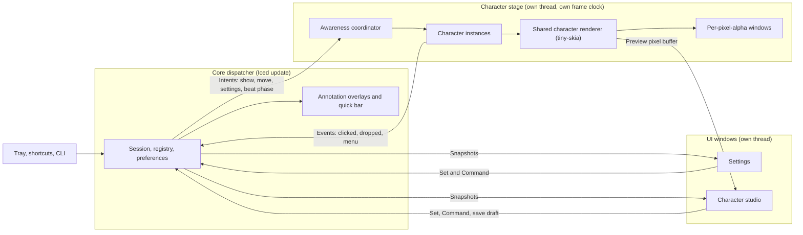

# Settings, character studio and multi-character plan

Updated 14 November 2026. Planned work, on branch `refactor/settings-registry`. Nothing in this plan is implemented yet.

This plan replaces the single event loop with three, moves characters to a native stage, rebuilds Settings and the character editor in a UI framework with an enforced design system, and adds several characters on the desktop. The [character and editor improvement plan](character-editor-improvement-plan.md) still governs artwork, poses and editor content. This document governs architecture, windows and delivery order.

## Outcome

- Ten or more characters run on the desktop, including several of the same character, and they are aware of each other.
- Settings is a list of registered pages and sections. Every control saves at once.
- Character editing happens in a separate Character studio window that works on a draft with one Save.
- Every window draws from one set of design tokens and one component kit, guarded by templates, a guide and a check in the test run.

## Decisions

| Decision | Status |
|---|---|
| The character studio is its own window | Agreed |
| The same character may appear more than once, each a separate instance | Agreed |
| Characters are aware of each other | Agreed |
| No hard cap on instances; ten or more must work | Agreed |
| Design is guarded by templates, a guide and unified styles | Agreed |
| Voice volume, lines on or off and Quiet are app settings; music pose and its standing threshold belong to the character | Agreed |
| One master switch shows or hides all characters; each instance keeps its own shown flag | Agreed |
| Code is licensed GPL-3.0-or-later; character artwork is not covered by the code licence | Agreed; licence files not yet added |
| Three loops, with characters on a native stage outside Iced | Proposed; assumed by this plan |
| Slint for Settings and the studio | Chosen. Step 0 measured it (see [Step 0 results](#step-0-results)) and the drag feel was confirmed by hand |
| Overlays and the quick bar stay on Iced | Proposed |

GPUI is the fallback for Settings and the studio if the Slint prototype fails on the canvas. It is not planned for overlays: it renders on the GPU only, and the overlay measured 640–820 ms to activate and about 180 MiB retained on a GPU surface (see [measurements](measurements.md)).

## Why the loop changes

All input, timers and results pass through one `App::update`, and Iced rebuilds the view of every open window after every message. The character's idle polling already drops to 15 per second while Settings is open to keep Settings responsive. With ten characters each ticking at display rate, every tick would rebuild every character window, Settings and the studio. This has been read from the code, not yet measured.

## Architecture

No per-frame traffic passes through the dispatcher. Frame clocks live inside the engines.



| Loop | Owns | Exchanges |
|---|---|---|
| Core dispatcher (the Iced `update`) | Session, registry, preferences, overlays, window lifecycle | Commands in, events out |
| Character stage (own thread and frame clock) | Instances, animation, physics, the awareness coordinator, drawing to per-pixel-alpha windows with tiny-skia | Intents in: show, move, settings changed, beat phase. Events out: clicked, dropped, menu requested |
| UI windows (Settings and studio) | Page state and drafts | The typed `Set` and `Command` path the CLI uses, plus snapshots from the core |

Lens already follows this shape: `platform/lens.rs` owns native instances behind a controller. Known desktop characters built from 2D sprites, such as Shimeji, use the same native-window approach.

One renderer draws the character for the stage and for the studio preview, into a pixel buffer. The studio shows that buffer and draws only the editing overlay (selection, handles, guides) itself, so the preview cannot drift from the desktop.

Settings and the studio run in-process on their own thread at first. Because they only exchange messages with the core, moving them to an on-demand process later is a contained change.

The speech bubble is drawn by the stage. The right-click menu becomes a short-lived window.

## Design system

Today only colour is tokenised. View code holds 214 literal font sizes, 161 paddings, 196 spacings and 52 colours outside `theme.rs`.

- Tokens: colour, type scale, spacing, radii and control heights, in one source that feeds both Slint and the Iced overlays.
- Component kit: page, section, setting row, buttons, segmented tabs, card, list row, notice, save bar. Pages and studio tabs build only from the kit.
- Templates: a Settings page template and a studio tab template.
- Guide: `docs/ui-guide.md` with the tokens, each component and when to use it, layout and wording rules, and a checklist for adding a page.
- Guard: a check in `cargo test` that fails on raw sizes, spacing or colours outside the kit and tokens.
- Gallery: a debug page showing every component in every state.

## Windows

The mockups below are the target layouts. Their sources are in [ui-mockups](ui-mockups/): one HTML file per screen and a shared `mockup.css` whose colours mirror `src/view/theme.rs`. Character thumbnails are placeholder icons. To change a screen, edit its HTML and render it again (see [Rendering the mockups](#rendering-the-mockups)).

Settings navigation:

- Annotate: Pointer, Ink & text, Spotlight & lens.
- Desktop: Characters, Music response.
- App: Shortcuts, Sound, Display & motion.

### Settings → Characters


- On the desktop lists instances, one compact row each: thumbnail, name and display, size slider with its value, show or hide, and a menu.
- The row menu holds Eyes follow the cursor, Idle motion and blinking, Reset position, Customize and Remove from desktop.
- Hide all hides every instance without removing it.
- Library lists characters. Add to desktop creates another instance of the selected character, so one character can appear several times.
- Customize opens the Character studio for the selected character. New starts Add character in the studio.
- Remove is unavailable for the built-in character.

### Settings → Music response


- The switch in the title row turns music response on for all characters.
- Listen to shows each source with a live meter and its state.
- Strength and Follow beat apply to every character.
- Bop, dance styles and hand tuning are not on this page. They belong to a character and are edited in its studio under Motion.

### Character studio


- The header holds the character picker, the unsaved state, Discard and Save. One Save writes artwork and behavior.
- The preview pane is fixed and stays in view on every tab. Test plays the character; Arrange moves layers. The buttons under it trigger reactions.
- The character picture in the preview comes from the shared renderer. The studio draws only the selection box, handles and guides over it.
- Tabs: Artwork, Reactions, Speech, Motion, Advanced.
- A reaction row is a collapsed summary of its picture and sound. It expands to show placement, cooldown and lines.
- One studio is open at a time. Closing it or changing character with unsaved work asks Save, Discard or Stay.

Not drawn yet: the Artwork, Speech, Motion and Advanced tabs, an expanded reaction row, and the Add character and From reference flows.

### Rendering the mockups

From `docs/ui-mockups`, with Microsoft Edge installed. Settings screens are 1000×680 and the studio is 1100×720.

```powershell
& "C:\Program Files (x86)\Microsoft\Edge\Application\msedge.exe" --headless=new --disable-gpu --hide-scrollbars --virtual-time-budget=6000 --window-size=1000,680 --screenshot="$PWD\settings-characters.png" "file:///$($PWD -replace '\\','/')/settings-characters.html"
```

Pages and sections are registered: a page has an ID, navigation group, label, icon and view; a section has an ID, title, view and search keywords; a simple setting is rendered from its `SettingDef`, whose `group` becomes a page and section ID.

## Setting scopes

| Scope | Examples | Stored in |
|---|---|---|
| App | Master show or hide, frame rate, voice volume, lines on or off, Quiet, music source, strength, beat engine, sensitivity and timing | The settings registry |
| Character | Artwork, lines, reactions, sounds and their volume, motion, bop, music pose and standing threshold, dance styles and hand tuning, sleep poses | The pack and its overrides |
| Instance | Character ID, shown, position, size, eyes, idle | A new instance store |

Music pose, the standing threshold, dance styles and hand tuning move from app scope to character scope. The other per-instance global keys migrate into the first instance.

Voice volume is one master volume for all characters. Each character's own sound switch and volume, already in its overrides, set the mix between characters.

### Showing and hiding

`mascot.enabled` becomes the master switch and keeps its ID. The tray's Show characters and `tinypaw mascot` toggle it; `tinypaw mascot-hide` turns it off. Hide all on the Characters page turns it off.

Each instance has its own shown flag, changed from its menu or its row in Settings. A character is visible when the master switch and its own flag are both on, so turning the master back on restores what was showing before and leaves individually hidden instances hidden.

## Awareness

| Tier | Behaviour | When |
|---|---|---|
| Spatial | Characters do not rest or land on each other | Step 6 |
| Turn-taking | One bubble and one voice at a time | Step 6 |
| Shared moments | One beat phase for all; all react to annotation ending | Step 6 |
| Social | Looking at each other, reacting to a neighbour, lines aimed at another character | Step 7 |

## Delivery order

| Step | Work | Done when |
|---|---|---|
| 0 | Slint prototype: Characters page and the studio preview pane with one draggable layer, software renderer | Drag feel, window open time, memory and overlay alignment under zoom are recorded, and the framework is chosen. Done: Slint chosen; drag feel confirmed by hand |
| 1 | Foundations: tokens, kit, templates, `docs/ui-guide.md`, the guard, and the typed boundary between core and UI | A sample page built only from the kit passes the guard |
| 2 | Shared character renderer: the rig draws to a pixel buffer without Iced | The current desktop character and preview render from it with pixel checks unchanged |
| 3 | Stage engine with one character | Same behaviour as today; no character traffic in the dispatcher; idle footprint within budget |
| 4 | Settings in the new framework: registry, then Sound, Display & motion, Shortcuts, Ink & text, Spotlight & lens, Pointer, Music response; first-run window | The Iced settings views are deleted; every control saves at once |
| 5 | Character studio window | Artwork, Reactions, Speech, Motion and Advanced work on one draft; Settings never shows the leave prompt |
| 6 | Multi-character: scopes, instance store and migration, Characters page, several instances, coordinator tiers one to three | An existing installation opens unchanged; two instances of one character move and size independently; 1, 10 and 20 instances are measured |
| 7 | Social awareness | Planned separately |

Each step ends with tests, strict Clippy and a Windows release build passing.

## Step 0 results

The prototype is in [prototypes/slint-studio](../prototypes/slint-studio/README.md): Slint 1.18.1, software renderer, a Characters page and a studio preview with one draggable layer. Release build, Windows 11, windows at their real sizes (1000×680 and 1100×720 logical). Times are means over 300 drag steps; "whole window" is a full software repaint, the worst case for presenting.

| Measure | 100% scale | 150% scale | 200% scale |
|---|---|---|---|
| Process start to event loop | 8 ms | 10 ms | 8 ms |
| Settings first full render | 4 ms | 8 ms | 13 ms |
| Studio first frame | 4 ms | 10 ms | 16 ms |
| Renderer plus hand-off per frame | 0.33 ms | 0.69 ms | 1.16 ms |
| Whole studio window repaint | 3.8 ms | 8.5 ms | 15.4 ms |
| Memory with both windows open (working set / private) | 15 / 3 MiB | 16 / 4 MiB | 17 / 5 MiB |
| Slint box against Rust layer edges | within 1 px | within 1 px | within 1 px |

The alignment test uses the green layer's exact pixels against the magenta box Slint draws, at zoom 0.5, 1, 1.37, 2 and 3 with fractional layer positions. At 200% the box sits two physical pixels outside the layer because its one logical pixel border is two physical pixels; that matches what was expected. At zoom 3 the layer runs past the bottom of the preview and is clipped, which shows as a one pixel difference at that edge.

What this says:

- **Hand-off is cheap.** Pushing a freshly rendered pixel buffer to Slint every frame costs about a millisecond even at 200%.
- **The overlay stays aligned.** Drawing the editing overlay in Slint from the same state as the renderer holds to a pixel across zoom and scale.
- **Memory and startup are small.** About 15 MiB with both windows open, and under 20 ms to a running event loop. This is in the range of the current tray footprint and far below a webview.
- **Slint redraws only what changed in normal use**, so a drag repaints the preview region, not the whole window. The whole-window figure is an upper bound; at 200% it is high enough that this has to be confirmed on screen.

The first hands-on drag was bad: the layer shook and trailed the cursor. Two causes were found and fixed, and both are rules for the real studio:

- **Put the touch area on a fixed surface, never inside the thing being dragged.** The prototype's touch area sat inside the box, and the box moves with the layer. Slint reports the cursor relative to the touch area, so the offset shrank as the layer moved and the layer settled at half the cursor's distance (a test reproduced exactly 50 px of lag over a 100 px drag, at every zoom). The touch area now covers the stage and works out whether the press landed on the layer. After the fix the layer follows the cursor with no gap at zoom 0.5, 1 and 2.
- **Redraw the picture when the state changes, not on a timer.** The box is drawn by Slint immediately but the picture came from a 16 ms timer, so the picture trailed the box by 3 to 6 px at a moderate drag speed. A change handler on the layer position and zoom now redraws the picture in the same frame, and the trail is 0 px. The frame timer is kept only for animation.

What is not known yet:

- **Drag feel with a real mouse after the fix, and display pacing.** The scripted tests use synthetic pointer events and CPU time, not frames shown. Drag the layer again to judge it.
- **Idle CPU.** The prototype redraws the preview at 60 frames a second all the time. The real renderer should draw only when something changes.
- **Wayland.** Not tried.

Findings for the design system:

- **Stock widgets do not take our tokens.** The standard Slider and Switch in the dark style use the style's blue accent, not the cyan in `Tokens`. A themed kit has to supply its own slider and switch, or override the style palette; the second option was not checked.
- **Custom kit components were quick to write.** Button, navigation item, tab, page title and hint came to about 90 lines, and the pages are written only from them and the tokens.
- **`SLINT_SCALE_FACTOR` was ignored by this backend.** Scale is changed by a window event in the test.
- **Slint's licence.** The crate is `GPL-3.0-only OR` a royalty-free licence `OR` a commercial one. Our code can still be GPL-3.0-or-later, but a built binary that includes Slint is effectively GPL-3.0-only.

## Working rules for implementers

- Do one step at a time, in order. Do not start a step whose "Done when" for the previous step is not met.
- Step 0 decides the framework. Do not build Settings or studio screens before it is recorded here.
- Match the mockups for layout, grouping and wording. Where a mockup and this text disagree, this text wins; fix the mockup.
- Build screens only from the component kit and tokens. A missing component is added to the kit, not written inline.
- Keep setting IDs stable. A setting that changes scope is migrated, never silently dropped.
- Keep per-frame work out of the core dispatcher.
- Record measurements in [measurements](measurements.md), and update this document's status line and decisions table when a step lands.

## Out of scope

- Moving overlays or the quick bar off Iced.
- A separate process for Settings and the studio.
- Linux and macOS for the new windows and the stage. Existing Linux scaffolding is kept.
- Pack format changes beyond what the scopes require.

## Risks

- The preview hand-off or overlay alignment in Slint may not hold up; step 0 exists to find out before anything depends on it.
- Two toolkits remain in the product, so tokens need one source.
- The interaction tests drive Iced layouts today and are rewritten for the new windows.
- Per-pixel hit testing and drag capture on native character windows must match today's behaviour.
- One window per instance may cost too much at twenty; one transparent stage window per display is the fallback.

## Licence

The code is licensed GPL-3.0-or-later. This matches Slint's GPL option and is compatible with GPUI's Apache-2.0 licence, so it holds whichever framework step 0 chooses. The artwork under `assets/mascot/yohta` is not covered by the code licence and needs its own terms.

To do in step 1: add the licence file and the `license` field in `Cargo.toml`, state the artwork terms, and check the full dependency list for compatibility.

## Open questions

- The terms for the Yohta artwork.
- Whether a single instance can be muted, and whether `tinypaw mascot <name>` is wanted. Neither is planned.
